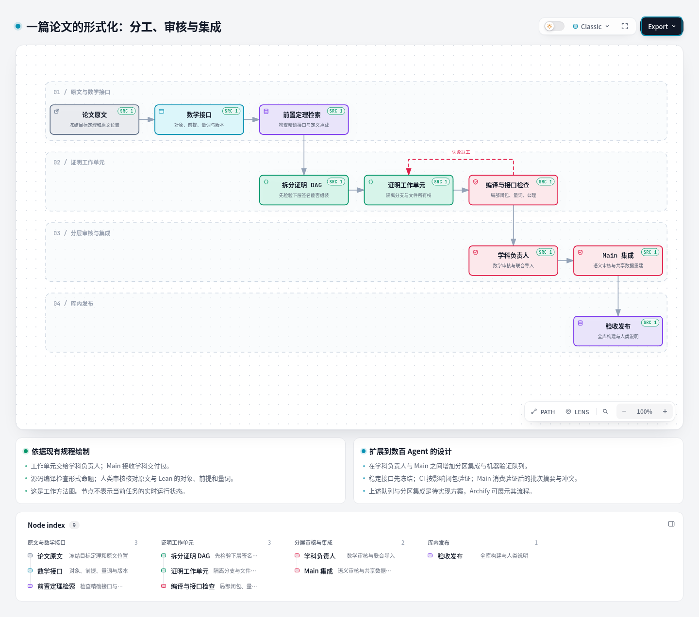
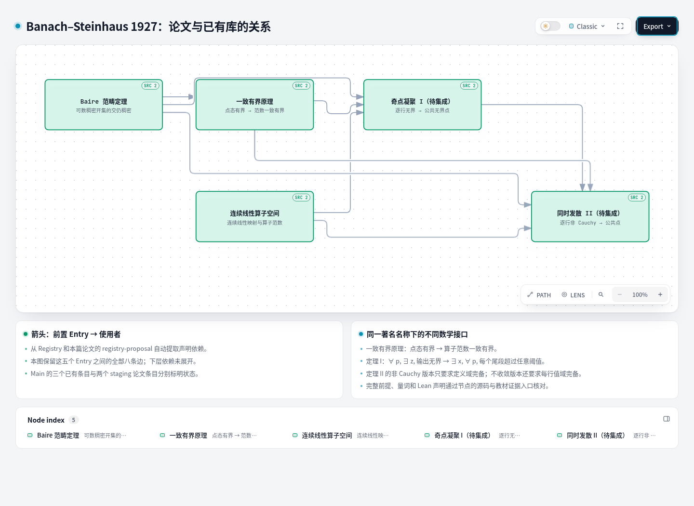

# Archify 对 Sandrone's Library 的可视化适用性

考察日期：2026-10-11。检查对象为 Archify 当天取得的 main 源码，包版本标记为 3.0.1。

**建议采用 Archify 作为项目介绍、论文证明关系和协作流程的展示工具。** 最先落地的是可独立打开的 HTML 阅读页，以及用于项目介绍 PDF 的 SVG 流程图。面向上万条目的检索和数百 Agent 的运行管理，需要在本项目中另建数据与服务层，再把选出的局部关系交给 Archify 展示。

这项判断来自源码检查和实际小样。小样包含真实 Entry 依赖、论文 staging 条目和现有工作规程，已经完成生成、产物检查、Chrome 检查、中文搜索、上游追踪及 SVG 导出。

## 1. 可以直接看到的结果

| 小样 | 交互阅读 | 用于文档的矢量图 | 浏览器截图 |
|---|---|---|---|
| Banach–Steinhaus 1927 论文与已有库 | [HTML](samples/paper-dependencies.html) | [SVG](samples/paper-dependencies.svg) | [PNG](samples/paper-dependencies.png) |
| 一篇论文的形式化分工、审核与集成 | [HTML](samples/paper-workflow.html) | [SVG](samples/paper-workflow.svg) | [PNG](samples/paper-workflow.png) |

HTML 可以下载后直接在浏览器打开。进入图中的节点可查看源码和教材文档证据，搜索按钮可按中文名称或文件路径定位节点，节点详情可追踪上游、下游关系。此小样采用本地证据模式：显示真实文件路径，阅读者通过本地仓库打开；发布后可以接入项目自身的源码阅读页。



工作流图依据 `INGESTION_PROTOCOL`、`LEAN-PLAYBOOK` 和 `MAIN-ROLE` 绘制。它描述工作方法；扩展队列和分区集成的设计放在说明卡中，尚未作为运行中的服务展示。



定理图使用 Main Registry 的三个已有条目，以及论文分支 `registry-proposal.json` 中的两个 staging 条目。保留这五个节点之间的全部八条声明依赖，箭头指向使用者；它是一个局部图，下层依赖没有展开。论文条目在图上明确标为“待集成”。Main Registry 本次读取有 565 个 verified Entry 和 694 条直接依赖边。

## 2. Archify 提供什么

Archify 的基本链路是“JSON 图描述 → 校验与布局处理 → 内含 SVG 的独立 HTML”。它提供 architecture、workflow、sequence、dataflow、lifecycle 五种图，阅读器提供节点查找、方向路径探查、上游和下游追踪、不同语义类型的筛选，以及 SVG 和位图导出。它也能把节点关联到特定仓库版本中的源码位置。[项目说明](https://github.com/tt-a1i/archify)、[阅读器说明](https://github.com/tt-a1i/archify/blob/main/archify/references/viewer-runtime.md)

| 本项目的需求 | 适用性 | 接入方法 |
|---|---|---|
| 给审阅者看论文形式化流程 | 很适合 | workflow 泳道表达论文接口、证明工作、学科审核和 Main 集成 |
| 看一个定理依赖哪些定义和引理 | 适合局部关系图 | 从 Registry 提取声明依赖，再添加源码和自然语言文档入口 |
| 说明同名定理的不同接口 | 适合展示，需提供数学数据 | 图上拆开版本，详情页逐项比较前提、量词、对象和结论 |
| 给项目介绍 PDF 提供科研流程图 | 很适合 | 导出 SVG；插入前检查最终字号和版面，需要 PDF 时再转换矢量格式 |
| 上万条目的全库浏览和精确检索 | 需要独立后端 | 先检索候选接口和局部子图，再渲染；总览采用学科聚合 |
| 数百 Agent 的实时运行管理 | 需要独立后端 | 调度器和事件库维护任务事实；图只显示聚合状态和选中任务的关系 |

渲染 CLI 要求 Node.js 18 以上；当前包没有运行时 npm 依赖，生成的 HTML 阅读不需要 Node.js。本次使用本地 Node.js 22.22.0，没有安装全局插件或技能。[package.json](https://github.com/tt-a1i/archify/blob/main/archify/package.json)

## 3. 著名定理只有共同名字：可视化怎样帮助解决

图节点应代表一个明确的数学接口。名称仅用于找到一组相关结果，真正可用于证明的是某一版本的精确声明。例如“Banach–Steinhaus”至少涉及本库的一致有界原理、1927 论文中的奇点凝聚定理 I，以及同时发散定理 II。

在小样中，它们分别成为节点。继续接入时，选择节点应打开一个面向数学工作者的接口卡：

| 接口卡字段 | 读者需要核对什么 |
|---|---|
| 自然语言陈述与原文位置 | 这是不是论文实际使用的那个结果 |
| 对象与正式承载 | 实或复标量、连续线性映射、范数、索引集合、定义域和值域 |
| 前提和量词 | 谁依赖谁；`∀ p, ∃ z` 与 `∃ x, ∀ p` 的区别；完备性加在哪里 |
| 完整 Lean 声明 | 采用的常量、隐式参数、类型类和结论 |
| 版本之间的关系 | 等价、特化、加强或推广；已有的转换桥及其所需前提 |
| 验证与审阅结果 | 编译通过的声明、接口对照记录、审阅结论和 Main 接收状态 |

本篇论文的具体差别很适合做成这样的卡：定理 I 将每行各自存在的无界点汇集为一个公共点；定理 II 的非 Cauchy 版本要求定义域完备，不收敛版本还需要每行值域完备。这些差别直接决定是否能够套用定理。

Archify 自带的源码证据检查核对文件及行范围在给定版本中是否存在。自然语言与 Lean 的对应关系由本项目的逐项审阅、定义展开、转换桥和语义例子支撑；展示页把这些证据连在一起，帮助人检查。[证据检查实现](https://github.com/tt-a1i/archify/blob/main/archify/renderers/shared/repository-evidence.mjs)

当前节点 schema 的数学信息承载比较简洁：主要是名称、副标题、标签和源码位置；没有专门的假设、结论、公式排版和审核记录字段。初期可以使用短节点标题、说明卡和外部接口页；成熟后再扩展数学节点与详情面板。本次用翻译配置把“后端”等默认类别名称改成数学接口用语。[architecture schema](https://github.com/tt-a1i/archify/blob/main/archify/schemas/architecture.schema.json)、[公共 schema](https://github.com/tt-a1i/archify/blob/main/archify/schemas/common.schema.json)

## 4. 上万条目时如何精准找到所需定理

建议把“找定理”作为一个先于绘图的工作环节。检索返回可用接口及理由，图负责解释选中接口的定义链和证明依赖。

1. **建立结构索引。** 保存 Entry ID、family/variant、名称别名、Lean 全名、参数类型、前提、结论结构、标量域、维数、完备性等条件，以及转换桥。类型和前提信息应来自 Lean 声明的导出，不能仅从标题猜测。
2. **先筛选对象，再召回候选。** 对象层级和必要前提先作过滤，名称、关键词与语义检索联合召回。检索“Banach–Steinhaus”会返回一组版本，每个候选展示适用条件与目标之间的差距。
3. **用 Lean 检验候选。** 在当前证明环境中测试实例化、类型类合成与可能的转换桥。检索排序表示候选优先级，Lean 测试结果表示接口是否能用于这个目标。
4. **展示选中接口的局部子图。** 展开直接前提、必要定义和桥；按依赖层逐步扩展，保留“还有多少节点未展开”的提示。全库页按学科、课程与定理族聚合，不在初始页面加载所有 Entry。

Archify 的 Node Finder 会对 ID、名称、副标题、标签、节点文本及源码位置作文本匹配。它没有上述类型约束检索、候选实例化和定理适用性判断。源码还显示，Finder 初始化时为每个节点扫描图中的边以统计连接，因此这一部分的工作量随节点数乘边数增长；大图需要改用预先建立的邻接索引。[Node Finder 实现](https://github.com/tt-a1i/archify/blob/main/viewer/node-finder.js)

## 5. 实测规模与布局限制

本次用合成的单链依赖图做了一次有时间上限的生成测试。每个节点连接下一个节点，使用 standard 质量设置；耗时包含 CLI 校验、路由与 HTML 生成，不包含浏览器加载、搜索交互或真实 Registry DAG 的布局。

| 合成节点数 | 边数 | 本次生成时间 | HTML 大小 |
|---:|---:|---:|---:|
| 100 | 99 | 0.131 秒 | 0.88 MB |
| 565 | 564 | 0.331 秒 | 1.55 MB |
| 1,000 | 999 | 0.700 秒 | 2.17 MB |
| 10,000 | 9,999 | 超过本次 15 秒限时 | 未生成 |

这是同一机器上的单次工程探查，不能据此推定真实全库的交互容量。它支持先使用局部图的接入策略；一万节点的端到端加载与交互仍需专门测试。脚本和原始记录分别见 [benchmark_render.py](benchmark_render.py) 与 [benchmark-results.json](benchmark-results.json)。

布局也需要由适配层承担：architecture 接收作者指定的位置或网格，不会自动把任意定理 DAG 排成好的科研图。当前 workflow schema 的列范围是 0–5；复杂长流程应分级拆图，或扩展 schema 和布局器。两张图均以 showcase 设置通过检查；定理图存在交叉线，已在浏览器截图中逐条检查，阅读时可使用路径高亮。[architecture 渲染器](https://github.com/tt-a1i/archify/blob/main/archify/renderers/architecture/render-architecture.mjs)、[workflow schema](https://github.com/tt-a1i/archify/blob/main/archify/schemas/workflow.schema.json)

## 6. 数百 Agent 时如何避免 Main 被压垮

建议从当前“工作单元 → 学科负责人 → Main”进一步发展为“工作单元 → 论文／学科审核 → 分区集成 → Main 发布”。扩容的关键是减少送到 Main 的独立接口变更和人工审阅次数。

- **接口先冻结。** 给任务分配声明、依赖和文件所有权；定义与高扇出接口变更进入专门迁移队列。同一接口的多个修改先在所属分区协调。
- **验证由队列执行。** CI 按受影响的依赖闭包编译并检查接口、占位和公理，缓存未变化的结果。任务失败回到负责该任务的审核者，分区只接收通过局部检查和数学审核的交付。
- **分区收敛提交。** 分区集成负责联合导入、跨任务接口冲突和规范化。Main 接收已有明确范围和验证结果的批次，集中处理跨分区定义、共享 Registry 和最终发布验收。
- **根据积压控制并发。** 调度器关注可运行任务、审核队列和集成队列长度；审核持续积压时降低新任务领取速度。让 Main 的输入规模随分区和发布批次数增长，而不是随原始 Agent 数量增长。
- **分层展示状态。** 顶层显示每个分区的等待、运行、待审和失败数；点击分区再显示论文 DAG，点击任务再看验证与审阅记录。实时状态来自任务事件库，并显示更新时间。

Archify 可以绘制这个组织结构，也可以展示后端生成的状态快照。任务租约、并发限额、状态事件、构建缓存、审核队列和集成策略需要在本项目实现。它的本地 preview 负责重新生成与预览图，没有承担上述调度功能。[Archify 使用规程](https://github.com/tt-a1i/archify/blob/main/archify/SKILL.md)

## 7. 建议的接入顺序

第一步复用本次两张图：把工作流 SVG 放入项目介绍，把论文关系图 HTML 作为审阅附件。第二步完善只读适配器，让 Registry、Entry、Lean 声明和审核结果共同生成节点详情与局部依赖图。第三步加入定理检索、邻接索引和分层视图。第四步在任务调度与 CI 事件服务具备后，接入多 Agent 的运行状态。

建议的数据链路为：

```text
Registry / Entry 文档 / Lean 声明 / 审阅与验证记录
                    ↓
只读适配器：接口卡、版本关系、局部依赖、布局坐标
                    ↓
Archify JSON → 校验 → 独立 HTML / SVG / PNG
```

这个接入顺序可以马上改善人类阅读体验，后续检索和运行管理也有明确的数据接口。源码和 Registry 继续维护数学事实，展示页消费这些事实。

## 8. 验证记录与复现

本次修改范围是独立分支 `codex/archify-feasibility` 的本目录，没有修改 Lean 证明、Registry、Playbook 或 Roadmap。现场源码版本和条目计数保存于 [source-manifest.json](source-manifest.json)。

- 定理图：5 节点、8 条声明依赖，生成、产物和浏览器检查全部通过。[最终检查摘要](samples/checks-dependencies/paper-dependencies.finalize-summary.json)
- 工作流图：9 节点、9 条关系，生成、产物和浏览器检查全部通过。[最终检查摘要](samples/paper-workflow.finalize-summary.json)
- 自定义交互检查：中文名称与源码文件查询各命中一个节点；定理 I 的上游追踪得到三个前置接口；两页在阻止 HTTP 请求的情况下加载，无页面脚本错误；两张 SVG 导出成功。[交互记录](samples/interaction-checks.json)
- 已查看两张最终 PNG，检查中文、节点位置、返回边和依赖连线。HTML 的部分工具栏名称仍为英文；正式中文站点可进一步统一阅读器文案。

Archify 在本次环境中的临时克隆位置是 `/tmp/archify-study-20261011`。生成过程只读输入仓库；重现时先获取 [Archify 源码](https://github.com/tt-a1i/archify)，把下列 `archify_source` 改为自己的源码目录。`library_main` 和 `paper_checkout` 分别指向 Main 和包含 Condensation 论文交付的工作树。

```bash
archify_source=/tmp/archify-study-20261011
library_main=/home/pisquare/czt/sandrones-library
paper_checkout=/home/pisquare/czt/sandrones-library-condensation
sample_dir=docs/reports/archify-feasibility/samples
evidence_dir="$sample_dir/checks-$(date +%Y%m%d-%H%M%S)"

python3 docs/reports/archify-feasibility/build_samples.py \
  --repo-root "$library_main" --paper-root "$paper_checkout" --output-dir "$sample_dir"

ARCHIFY_UPDATE_CHECK_DISABLED=1 node "$archify_source/archify/bin/archify.mjs" \
  finalize architecture "$sample_dir/paper-dependencies.json" "$sample_dir/paper-dependencies.html" \
  --repo-root "$paper_checkout" --quality showcase --out-dir "$evidence_dir" --json

ARCHIFY_UPDATE_CHECK_DISABLED=1 node "$archify_source/archify/bin/archify.mjs" \
  finalize workflow "$sample_dir/paper-workflow.json" "$sample_dir/paper-workflow.html" \
  --repo-root "$library_main" --quality showcase --out-dir "$evidence_dir" --json

python3 docs/reports/archify-feasibility/capture_samples.py --samples "$sample_dir"

python3 docs/reports/archify-feasibility/benchmark_render.py \
  --archify-root "$archify_source" --result docs/reports/archify-feasibility/benchmark-results.json
```

截图脚本使用 Python Playwright 和本机 Chrome，浏览 HTML 本身不需要这些工具。每次重新生成使用独立的检查输出目录，保留不同产物的检查证据，避免旧证据与新图冲突。

Archify 采用 [MIT 许可](https://github.com/tt-a1i/archify/blob/main/LICENSE)。本交付保存 [Archify 版权许可](third-party/Archify-LICENSE.txt) 和 [嵌入字体许可](third-party/JetBrainsMono-OFL.txt)。
